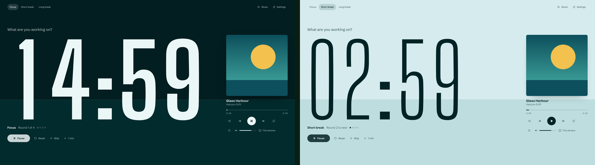

# Tide

A focus timer for a second monitor that plays your Spotify music and pauses it on breaks.

The whole window is the timer. It fills from the bottom as a session passes, so you can read it from the corner of your eye. Focus is a dark room tinted by the album art, breaks are light, and the numbers go hollow whenever the timer isn't running.

## Features

- Focus, short break and long break at any length, with presets for 25/5, 50/10 and 90/20
- Plays Spotify inside the window, or controls Spotify on your other devices
- Music fades out when a break starts and picks up where it left off when you focus. It can also switch to a break playlist, turn the volume down, or keep playing
- Playlists, liked songs, search, queue, shuffle, repeat, likes, volume and device switching
- Keyboard shortcuts, a chime, desktop notifications and keeping the screen awake
- Installs as an app, and opens without the local server after the first run

## Requirements

- Windows 10 or 11 with Chrome or Edge
- Spotify Premium, which Spotify requires for developer apps

## Quick start

1. Download or clone this repository.
2. Double-click `Start Tide.bat`. Tide opens at http://127.0.0.1:8457.
3. Follow the steps on screen to create a Spotify developer app with the redirect URI `http://127.0.0.1:8457/callback`, then paste in its Client ID.

[README.txt](README.txt) has the full setup guide and troubleshooting.

## How it works

Tide is one page, `app/index.html`, with no build step and no dependencies. `server.ps1` is a small web server that uses only the PowerShell built into Windows, because Spotify only accepts `127.0.0.1` or `https` addresses for sign-in. Sign-in uses Spotify's Authorization Code flow with PKCE, so there is no client secret. Your Client ID and sign-in are kept in your browser, not in these files.

## Credits

Fonts: Big Shoulders Display and Schibsted Grotesk, both under the SIL Open Font License (see `app/fonts`).
